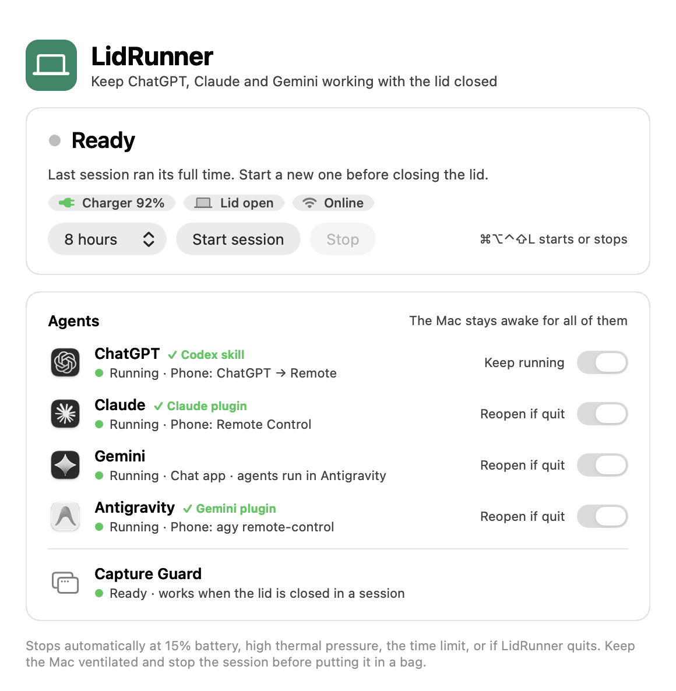
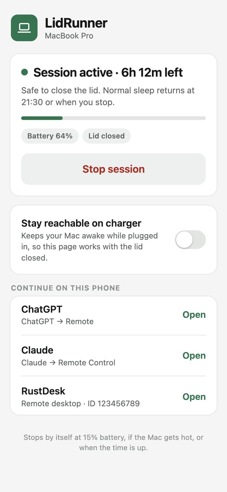

# LidRunner

A macOS menu-bar app for closed-lid work sessions on a MacBook, on charger or battery. Keep local work running with optional app keep-alive, a phone remote, and agent integrations for ChatGPT/Codex, Claude, Gemini, and Antigravity. Works alongside remote-desktop tools such as RustDesk.



> **Experimental power-management utility.** Closed-lid operation can consume battery and generate heat. Keep the Mac ventilated and stop the session before putting it in a bag. An active power session is not proof that remote access, screenshots, or computer control will work.

## Features

- Manual 1-, 2-, 4-, or 8-hour sessions, with a menu-bar countdown.
- **Command–Option–Control–Shift–L** (⌘⌥⌃⇧L) starts a session of the selected length (eight hours by default) or stops the current session.
- A notification explains any session that ends on its own (time limit, battery, heat), so a Mac found asleep is never a mystery.
- A bounded privileged helper restores normal sleep on expiry, app exit, stale heartbeat, low battery, or serious thermal pressure.
- Optional keep-alive for installed agent and remote-desktop apps (ChatGPT, Claude, Gemini, Antigravity, RustDesk), plus any app you add with **Add app…**, without force-quitting running apps.
- Optional **Phone remote**: a page on your phone that shows the Mac's state and starts or stops sessions, over your Wi-Fi or Tailscale. Off by default; see [Phone remote](#phone-remote).
- Optional **Stay reachable on charger**: while plugged in, the Mac stays awake with the lid closed so your phone and remote tools can always reach it.
- Optional **Capture Guard** companion for a specific shared-window screenshot-clipping workaround. The main window shows whether it is running and has its permission.
- Read-only agent skills and lifecycle hooks that report lid and session state.

## Requirements

- A MacBook and Xcode command-line tools (`xcode-select --install`).
- Python 3 for optional agent integration and its tests.
- Administrator approval when the power helper is first installed.

Development testing was performed on Apple silicon with macOS 27.2. The app declares macOS 13.0 as its minimum system version, but compatibility with other macOS releases and Intel Macs has not been verified. Builds are locally signed, not notarized release downloads.

## Build and install

```sh
git clone https://github.com/anmolbhatia2013/LidRunner.git
cd LidRunner
./install.sh
```

`./install.sh` builds the app and helper, runs the power-policy tests, installs or upgrades `~/Applications/LidRunner.app`, and opens it. It refuses to run while a session is active, and it quits a running copy before replacing it. Add `--capture-guard` to install or upgrade the companion too, or `--no-launch` to skip opening the app.

`./build.sh` alone compiles and tests without installing (`--build-only` skips the tests). Build output is kept in `build/` and is not committed.

Builds are ad-hoc signed unless you set `LIDRUNNER_SIGNING_IDENTITY` (or keep a certificate fingerprint in the untracked `capture-signing-identity.txt`). A stable identity matters for two macOS approvals that are tied to the code signature: Capture Guard's Accessibility permission and the firewall's permission for Phone remote. With ad-hoc signing, expect to grant both again after each rebuild.

## Use

1. Open LidRunner, select a session length and choose **Start session**, or press **⌘⌥⌃⇧L** to start one of the selected length. The choice is remembered; it starts at eight hours.
2. On first use, approve the normal macOS administrator prompt to install the narrowly scoped helper. No password is stored.
3. Wait for **Session active** before closing the lid.
4. Choose **Stop session** or press the shortcut again to restore normal sleep early.

Closing the app window does not stop the session; quitting the menu-bar app does. If a start fails while the window is closed (for example from the shortcut), the window opens to show why. The first session asks for permission to send one kind of notification: a session that ended without you stopping it. Login launch can be controlled from the app's menu. Opening the app does not automatically start a power session.

Keep-alive preferences appear for installed apps. ChatGPT may be opened during a session even if it was initially closed; other supported apps are reopened only if they were seen running earlier in that session. Retries use a 15-second debounce, at least 60 seconds between attempts, and a three-attempt cap. No app is signed in or granted permissions automatically.

## Phone remote



A sleeping Mac cannot hear anything, so nothing can wake a closed, sleeping MacBook from a phone. The phone remote therefore does two things: it controls a Mac that is awake, and **Stay reachable on charger** keeps a plugged-in Mac awake so there is something to control.

**Set up**

1. In LidRunner, turn on **Phone remote** and choose **Pair phone…**.
2. Scan the code with the phone's camera. To keep it as an app, use Share → Add to Home Screen.
3. If macOS asks whether LidRunner may accept incoming connections, allow it. If the window says "Blocked by the macOS firewall", allow LidRunner in System Settings → Network → Firewall → Options. LidRunner checks this itself and tells you.

The phone must be on the same Wi-Fi as the Mac, or both must be on Tailscale. Each network has its own pairing link (the window offers both), because the page's saved pairing is tied to the address it was opened from.

**What the page can do:** show session state, battery, lid and charger; start a 1-, 2-, 4- or 8-hour session; stop a session; switch Stay reachable on or off; and open ChatGPT, Claude or RustDesk on the phone when they are running on the Mac. That is the whole list. It cannot run commands, read files, see the screen, or change any other setting.

**Stay reachable on charger** holds a charger-only session for as long as the Mac is plugged in. The display still sleeps and locks normally. The helper ends the hold two minutes after the charger is disconnected, so an unplugged Mac in a bag goes to sleep; on battery, start a normal timed session before closing the lid. Turning it on needs a one-time administrator approval at the Mac, because it updates the privileged helper.

**Security model**

- Off by default. The listener exists only while Phone remote is on.
- Connections are accepted only from loopback, private LAN ranges and Tailscale addresses. Public addresses are refused even if a router forwards the port.
- Every request except the static page is signed (HMAC-SHA256) with a 256-bit pairing secret. The secret is shown once as a QR code on the Mac's own screen and is never sent over the network, so plain HTTP on a shared Wi-Fi exposes no credential. Signed requests carry a timestamp and a single-use nonce; replays and stale requests are rejected, and repeated bad signatures lock the remote for five minutes.
- The secret is stored in `~/Library/Application Support/LidRunner/remote-secret`, readable only by you. **Reset pairing…** replaces it and unpairs every phone.
- Not protected: on a shared network someone can see that a LidRunner remote exists, and an attacker who can tamper with traffic could show your phone a false status. They still cannot issue commands. Anyone who obtains the pairing code can start and stop sessions, so treat it like a password.

## Safety and recovery

- Changes only `pmset -a disablesleep`, and requires its initial value to be zero. It does not change sleep timers, screen locking, FileVault, network settings, or app permissions.
- The root-owned helper accepts only bounded session requests from the administrator-configured user and fixed paths, not arbitrary commands.
- A root-owned journal is written before changing sleep. A restarted helper restores normal sleep instead of resuming a prior session.
- The helper checks every two seconds and restores sleep on expiry, app-process loss, a missing/stale heartbeat (20 seconds), battery at or below 15% while unplugged, unavailable battery readings while unplugged, or serious/critical thermal pressure.
- Manual sleep may be inhibited during a session. Stop LidRunner first.
- Recovery depends on macOS and launchd remaining operational. This is not a hardware-level safety guarantee.

Emergency restoration in Terminal:

```sh
sudo /usr/bin/pmset -a disablesleep 0
```

## Remote access and screenshot limitations

LidRunner's optional [phone remote](#phone-remote) only starts and stops sessions; it is not a remote desktop and carries no screen, keyboard or files. For actual remote work, use your agent's existing authenticated remote connection, or a remote-desktop tool such as RustDesk, with their normal permission controls. For unattended ChatGPT computer use after locking, use the app's official **Locked use** setting where available. LidRunner does not bypass locking or permission prompts.

A sleeping or powered-off Mac cannot be revived through LidRunner. Internet loss, session expiry, battery/thermal cutoff, or an unavailable agent app can interrupt remote work.

Apple's standard closed-display configuration uses power, an external display, and external input devices. LidRunner's software-only approach relies on the `disablesleep` setting, which is not documented in the local `pmset` manual and may change in future macOS versions. It installs no virtual display.

If an app screenshot becomes partly blank after a lid/display transition, its **Window → Center** command may help. This was observed with Calculator, not established as a universal fix. The optional [Capture Guard companion](CAPTURE-GUARD.md) automates a narrowly scoped version of that workaround.

## Agent integrations

See [agents/README.md](agents/README.md) for the shared skill and plugin, installation, tests, hook behavior, and removal. Installing agent integrations is separate from building the macOS app and can modify the selected agent's user-level configuration.

## Tests and verification boundary

```sh
# Build and run power-policy checks
./build.sh

# Build and run Capture Guard policy checks
./build-capture-guard.sh

# Read-only agent unit tests; no model request
python3 agents/tests/test_closed_lid_skill.py
```

Historical local testing included short charger/battery lid-close sessions, background execution, app input, a phone-to-host ChatGPT Remote interaction, and Calculator screenshot recovery. In normal use on 10 November 2026, a closed-lid battery session ran for about two and a half hours and the helper restored sleep at the 15% cutoff. Those observations are not a reliability guarantee or proof of compatibility with arbitrary apps. Full eight-hour runs, reboot/crash recovery, the high-temperature cutoff, and closed-lid Claude/Antigravity remote transport have not been physically exercised.

GitHub Actions runs the three commands above on every push and pull request.

Phone remote (1.5) was verified on the Mac itself: the protocol rules by 125 policy checks, the listener by an independent signed client (including replayed, stale, mis-signed and malformed requests), and the page in a phone-sized browser that started and stopped a real session. It has **not** yet been used from a physical phone, over Tailscale, or with the lid closed. Stay reachable on charger and the helper change behind it are covered by policy checks only: the updated helper has not been installed or run, because that needs an administrator approval.

Local evidence logs and installation records are intentionally excluded from this repository. Automated policy tests do not substitute for real-device verification.

## Privacy and local files

The macOS app sends no requests to the internet. With Phone remote off (the default) it has no network activity at all; with it on, it listens for your phone as described under [Phone remote](#phone-remote) and periodically connects to its own address to check that the firewall is not blocking it. Diagnostics describe power/session/display state, not document contents, task prompts, or screenshots. The sampling history (`verification.jsonl`, rotated at 10 MB) records every two-second sample during a session, and otherwise only state changes plus one sample a minute.

- App source: `Sources/`
- Policy tests: `Tests/`
- User diagnostics: `~/Library/Application Support/LidRunner/`
- Root request/journal: `/Library/Application Support/LidRunner/`
- Privileged helper: `/Library/PrivilegedHelperTools/com.anmolbhatia.lidrunner`
- Launch daemon: `/Library/LaunchDaemons/com.anmolbhatia.lidrunner.plist`

Builds, evidence logs, old backups, local registration records, and machine-specific signing settings are ignored by Git. See [IMPLEMENTATION.md](IMPLEMENTATION.md) for process boundaries.

## Remove

Disable **Open at Login**, stop the session, and quit LidRunner. The uninstaller unconditionally restores `disablesleep` to zero, so do not run it while another utility relies on that override. Then run:

```sh
./uninstall.sh
```

The script restores sleep and removes LidRunner's installed helper, daemon, app, and Capture Guard companion. Source and diagnostic history are retained. Agent integrations have separate removal instructions in [agents/README.md](agents/README.md).

## References

- [Apple: using an external display with a closed Mac laptop](https://support.apple.com/en-au/102501)
- [ChatGPT settings](https://learn.chatgpt.com/docs/reference/settings)
- [ChatGPT Computer Use](https://learn.chatgpt.com/docs/computer-use)
